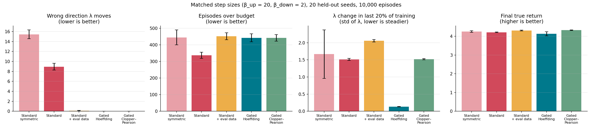
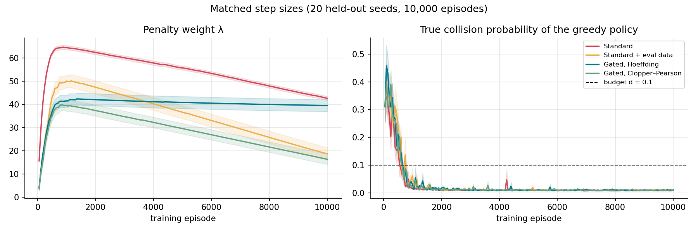
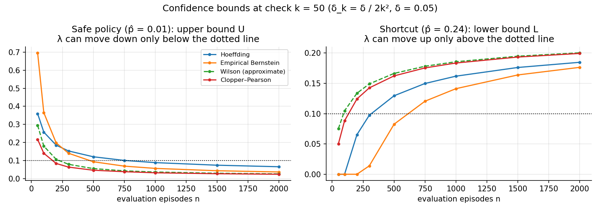

# Confidence Gated Lagrangian Updates for Safe Reinforcement Learning

ECE 59500 Reinforcement Learning course project.
Team: Abhishek Tyagi, Ashish Kale, Ayush Kumar.

A delivery robot in a slippery gridworld must reach its goal while keeping the chance of a
collision per episode at or below d = 0.1. We compare ways of tuning the collision penalty λ:

| Method | Rule |
|---|---|
| Fixed λ | hand picked, never changes |
| Standard Lagrangian | λ ← max(0, λ + β(p̂ − d)), p̂ from the last K training episodes |
| Standard + eval data | same rule, but p̂ from the same n evaluation episodes the gated rule uses (separates the effect of gating from the effect of extra data) |
| Gated (ours) | freeze the greedy policy, run n evaluation episodes, build a confidence interval [L, U] on the collision rate, and move λ only when the interval is fully above or fully below d |

Every rule can use separate step sizes for raising λ (β_up) and lowering it (β_down).

## Environment


With probability 0.1 the robot slips and moves in a random direction. Reward is −1 per step and
+20 at the goal; entering an obstacle ends the episode with cost 1. The model is known, so the
code computes the **exact** collision probability of any policy (`GridWorld.evaluate`). We use it
as ground truth to count episodes over budget and to check whether each λ move went the right way.

## Main result: matched step sizes

All rules below use the same steps (β_up = 20, β_down = 2), so the only difference between them is
what decides a move. 20 held-out seeds (100 to 119, never used for tuning), 10,000 episodes each.
Mean ± standard error.



| Method | Wrong direction λ moves | Episodes over budget | Over budget, 2nd half | λ change, last 20% | Final return |
|---|---|---|---|---|---|
| Standard, symmetric (β = 20) | 15.45 ± 0.90 | 445 ± 45 | 98 ± 36 | 1.67 ± 0.71 | 4.26 ± 0.04 |
| Standard | 8.95 ± 0.68 | **338 ± 18** | 0 | 1.51 ± 0.03 | 4.21 ± 0.02 |
| Standard + eval data | 0.10 ± 0.07 | 453 ± 21 | 2.5 ± 2.5 | 2.06 ± 0.04 | 4.31 ± 0.02 |
| **Gated, Hoeffding (ours)** | **0** | 443 ± 24 | 2.5 ± 2.5 | **0.13 ± 0.01** | 4.13 ± 0.11 |
| Gated, Clopper–Pearson | **0** | 443 ± 20 | 0 | 1.52 ± 0.02 | 4.32 ± 0.02 |



**Answer to the research question** (gated Hoeffding vs standard, paired on the same seeds):

| Part of the question | Answer | Paired difference |
|---|---|---|
| Does gating make λ steadier? | **Yes, about 11× steadier** | −1.38 ± 0.03 |
| Does gating reduce episodes over budget? | **No, it adds some** | +105 ± 27 |
| Is the final return within 5%? | **Yes** (98%) | −0.08 ± 0.10 (not significant) |
| Wrong direction moves | **0 vs 8.95**, as the proof predicts | −8.95 ± 0.68 |

**What we learned**

1. **The gated rule never moved λ in the wrong direction**: 0 in all 259 gated runs, with every bound and budget. The proof is in [`docs/proof.md`](docs/proof.md).
2. **Most of that gain comes from the evaluation data.** Given the same evaluation episodes, the standard rule drops from 8.95 to 0.10 wrong moves. Gating removes the rest and comes with a guarantee.
3. **Gating costs some early safety.** It waits for clear evidence before raising λ, while the standard rule reacts to every noisy batch. That shows up as about 105 more episodes over budget, about 92 of them in the first 800 episodes.
4. **With Hoeffding, gating holds λ almost flat** once the policy is safe, while every other rule keeps lowering it. This is the 11× steadier λ.
5. **Asymmetric steps, not gating, stop the late relapse.** With symmetric steps every rule slowly drives λ back toward 0 and the robot drifts back into the corridor (see the step 3 results below). Lowering λ 10× slower than it is raised fixes this for every rule.

### Which confidence bound?



Tighter bounds (Clopper–Pearson, Wilson) let λ move sooner in both directions. That helps detect a
violation, but it also lowers λ faster once the policy is safe, which with symmetric steps caused more
late violations (`configs/bounds.yaml`). With too few evaluation episodes (n = 250 with Hoeffding) the
interval nearly always contains d, λ freezes at its early peak and the return collapses. Wilson is
tight but only approximate, so the guarantee does not formally cover it; Clopper–Pearson is just as
tight and keeps the guarantee.

### Budget sweep (d = 0.05 and 0.15, 5 tuning seeds)

The same pattern holds at both budgets. With a tight budget (d = 0.05) the standard rule made **55**
wrong moves per run: its training data includes exploration crashes, so it keeps raising λ even when
the greedy policy is safe. The gated rule made 0 and had the best return (4.27), but Hoeffding held λ
still 96% of the time.

### Earlier results: symmetric steps (step 3)

Tuned symmetric steps, 20 held-out seeds, 6,000 episodes:


Over 20,000 episodes every symmetric rule, gated included, drives λ back toward 0. The safe route's
collision probability (about 0.01) is far below the budget, so each rule keeps lowering the penalty
while the robot is safe:


## Setup

```bash
python -m venv .venv
# Windows:  .venv\Scripts\activate      macOS/Linux:  source .venv/bin/activate
pip install -r requirements.txt
```

## Run

```bash
python run_experiment.py configs/baselines.yaml            # quick first look, 5 seeds
python run_experiment.py configs/baselines.yaml --seeds 2  # even quicker test
python plot_results.py results/baselines
```

Experiments, in order:

| Config | Purpose | Seeds | Time |
|---|---|---|---|
| `configs/baselines.yaml` | first look at all methods | 0 to 4 | ~15 s |
| `configs/tune.yaml` | pick the symmetric step size β of each rule | 0 to 4 | ~1 min |
| `configs/long_check.yaml` | 20,000 episodes: does λ decay back to 0? | 0 to 2 | ~1 min |
| `configs/final.yaml` | step 3 final comparison, symmetric steps | 100 to 119 | ~2 min |
| `configs/bounds.yaml` | Hoeffding vs Bernstein vs Wilson vs Clopper–Pearson, n = 100 to 1000 | 0 to 9 | ~3 min |
| `configs/asym.yaml` | asymmetric steps for the gated rule | 0 to 9 | ~3 min |
| `configs/asym_standard.yaml` | the same asymmetric steps for the standard rules | 0 to 9 | ~2 min |
| `configs/final_matched.yaml` | **main result**: matched steps, all rules | 100 to 119 | ~4 min |
| `configs/budget_sweep.yaml` | run with `--budget 0.05` and `--budget 0.15` | 0 to 4 | ~1 min each |

Each run prints a table of means over seeds and writes `summary_mean.csv`.
After `final.yaml`, `long_check.yaml` and `final_matched.yaml` have run, rebuild the figures with:

```bash
python make_figures.py
```

Results go to `results/<config name>/`:
- `summary.csv`: one row per method and seed
- `summary_mean.csv`: mean over seeds, one row per method
- `training_curves.png`: λ, true collision probability and true return over training
- `<method>_seed<k>.npz`: full logs of each run

## Metrics (in `summary.csv`)

| Column | Meaning |
|---|---|
| `final_p_true` | exact collision probability of the final greedy policy |
| `final_return_true` | exact expected return of the final greedy policy |
| `episodes_over_budget` | training episodes during which the greedy policy's true p was above d |
| `over_budget_2nd_half` | the same, second half of training only (catches drifting back into the shortcut) |
| `training_collisions` | crashes that happened while learning |
| `lambda_max` | highest λ reached (overshoot) |
| `lambda_std_last20pct` | how much λ still changes late in training |
| `wrong_direction_moves` | λ went up while true p ≤ d, or down while true p > d |
| `frozen_fraction` | share of checks where λ did not move |
| `eval_episodes_used` | extra evaluation episodes the method needed |
| `eval_collisions` | crashes during those evaluation episodes |

## Project structure

```
safe_rl/
  gridworld.py   environment, batch rollouts, exact evaluation, value iteration reference
  agent.py       tabular Q learning on r − λc
  updates.py     λ update rules and confidence bounds (Hoeffding, Bernstein, Wilson, Clopper–Pearson)
  train.py       training loop and summary metrics
configs/         experiment settings (one YAML file per experiment)
docs/proof.md    proof of the wrong direction bound
docs/figures/    figures used in this README (rebuilt by make_figures.py)
run_experiment.py
plot_results.py   training curves for any results folder
make_figures.py   README and report figures
```

## Roadmap

- [x] Step 2: environment, Q learning, fixed and standard Lagrangian baselines, gated update with Hoeffding
- [x] Step 3: tune β, add the standard + eval data baseline, final comparison with 20 seeds
- [x] Step 4: Wilson, Bernstein and Clopper–Pearson bounds, sweeps over n, β and d, asymmetric steps, proof of the wrong direction bound
- [ ] Step 5: report, recorded presentation
