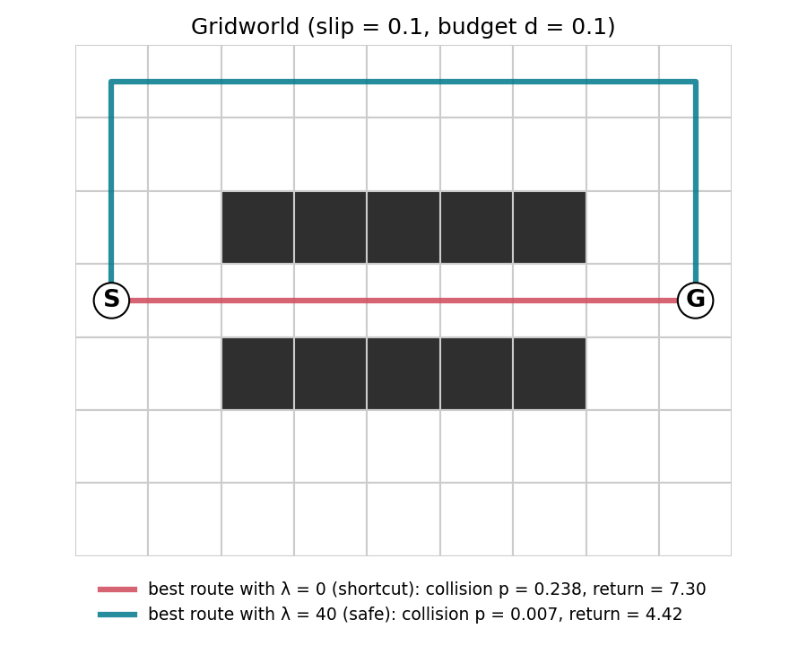
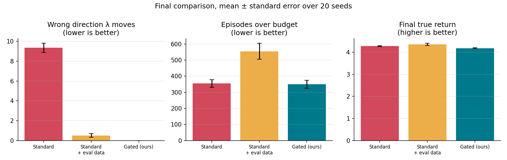
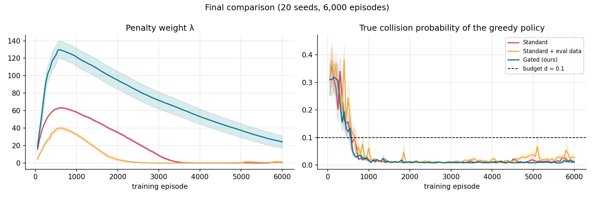
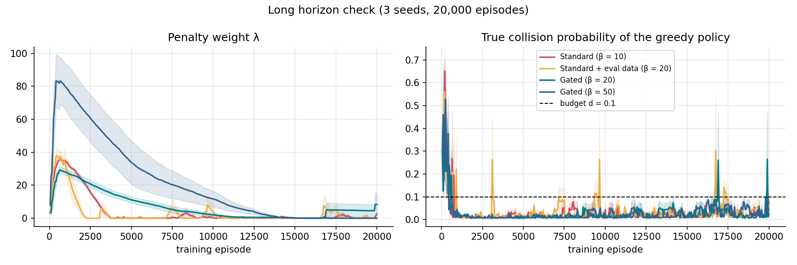

# Confidence Gated Lagrangian Updates for Safe Reinforcement Learning

ECE 59500 Reinforcement Learning course project.
Team: Abhishek Tyagi, Ashish Kale, Ayush Kumar.

A delivery robot in a slippery gridworld must reach its goal while keeping the chance of a
collision per episode at or below d = 0.1. We compare ways of tuning the collision penalty λ:

| Method | Rule |
|---|---|
| Fixed λ | hand picked, never changes |
| Standard Lagrangian | λ ← max(0, λ + β(p̂ − d)), p̂ from the last K training episodes |
| Standard + eval data | same rule, but p̂ from the same n evaluation episodes the gated rule uses (separates the effect of gating from the effect of extra data) |
| Gated (ours) | freeze the greedy policy, run n evaluation episodes, build a confidence interval [L, U] on the collision rate, and move λ only when the interval is fully above or fully below d |

## Environment



With probability 0.1 the robot slips and moves in a random direction. Reward is −1 per step and
+20 at the goal; entering an obstacle ends the episode with cost 1. The model is known, so the
code computes the **exact** collision probability of any policy (`GridWorld.evaluate`). We use it
as ground truth to count episodes over budget and to check whether each λ move went the right way.

## Results

Final comparison on 20 seeds (100 to 119) that were never used for tuning, 6,000 training episodes each.
Step sizes were picked on separate tuning seeds with one rule for every method (fewest episodes over budget).



| Method | Wrong direction λ moves | Episodes over budget | Final collision p | Final return | λ swing (last 20%) |
|---|---|---|---|---|---|
| Fixed λ = 0 | 0 | 5,670 | 0.229 | 7.08 | 0 |
| Fixed λ = 30 | 0 | 380 | 0.010 | 4.18 | 0 |
| Standard (β = 20) | 9.35 | 355 | 0.013 | 4.27 | 0.67 |
| Standard + eval data (β = 20) | 0.50 | 555 | 0.027 | 4.35 | 0.99 |
| **Gated (ours, β = 100)** | **0** | **350** | **0.011** | 4.18 | 4.72 |



**What we see so far**

1. **The gated rule never moved λ in the wrong direction**, matching the theory. The standard rule did so about 9 times per run.
2. **Most of that gain comes from better data, not from gating.** The standard rule fed the same evaluation episodes drops to 0.5 wrong moves. Gating removes the rest.
3. **Episodes over budget are about the same** for the standard and gated rules (355 vs 350). Most of them happen in the first ~700 episodes, before any rule has learned a safe route.
4. **The gated rule's final return is within 5% of the standard rule's** (4.18 vs 4.27), as the research question requires.
5. **The gated rule swings λ more, not less**, at this step size. It overshoots to about 130 early and then decays slowly.

**Long horizon check (20,000 episodes)**



Every rule, gated included, eventually drives λ back toward 0. The safe route's collision probability (about 0.01) is far below the budget, so each rule keeps lowering the penalty while the robot is safe. Gating slows the decay but does not stop it. Q learning keeps avoiding the corridor for a long time after the penalty is gone, so the resulting violations appear as occasional spikes rather than a clean switch.

## Setup

```bash
python -m venv .venv
# Windows:  .venv\Scripts\activate      macOS/Linux:  source .venv/bin/activate
pip install -r requirements.txt
```

## Run

```bash
python run_experiment.py configs/baselines.yaml            # quick first look, 5 seeds
python run_experiment.py configs/baselines.yaml --seeds 2  # even quicker test
python plot_results.py results/baselines
```

Experiments, in order:

| Config | Purpose | Seeds | Time |
|---|---|---|---|
| `configs/baselines.yaml` | first look at all methods | 0 to 4 | ~15 s |
| `configs/tune.yaml` | pick the step size β of each rule | 0 to 4 | ~1 min |
| `configs/long_check.yaml` | 20,000 episodes: does λ decay back to 0? | 0 to 2 | ~1 min |
| `configs/final.yaml` | final comparison with the tuned β | 100 to 119 (never used for tuning) | ~2 min |

Each run prints a table of means over seeds and writes `summary_mean.csv`.

After `final.yaml` and `long_check.yaml` have run, rebuild the README figures with:

```bash
python make_figures.py
```

Results go to `results/<config name>/`:
- `summary.csv`: one row per method and seed
- `training_curves.png`: λ, true collision probability and true return over training
- `<method>_seed<k>.npz`: full logs of each run

## Metrics (in `summary.csv`)

| Column | Meaning |
|---|---|
| `final_p_true` | exact collision probability of the final greedy policy |
| `final_return_true` | exact expected return of the final greedy policy |
| `episodes_over_budget` | training episodes during which the greedy policy's true p was above d |
| `training_collisions` | crashes that happened while learning |
| `lambda_std_last20pct` | how much λ still swings late in training |
| `wrong_direction_moves` | λ went up while true p ≤ d, or down while true p > d |
| `frozen_fraction` | share of checks where λ did not move |
| `eval_episodes_used` | extra evaluation episodes the method needed |
| `eval_collisions` | crashes during those evaluation episodes |

## Project structure

```
safe_rl/
  gridworld.py   environment, batch rollouts, exact evaluation, value iteration reference
  agent.py       tabular Q learning on r − λc
  updates.py     λ update rules and confidence bounds
  train.py       training loop and summary metrics
configs/         experiment settings (one YAML file per experiment)
docs/figures/    figures used in this README (rebuilt by make_figures.py)
run_experiment.py
plot_results.py   training curves for any results folder
make_figures.py   README and report figures
```

## Roadmap

- [x] Step 2: environment, Q learning, fixed and standard Lagrangian baselines, gated update with Hoeffding
- [x] Step 3: tune β, add the standard + eval data baseline, final comparison with 20 seeds
- [ ] Step 4: Wilson and Bernstein bounds, sweeps over d, n and β, proof of the wrong direction bound
- [ ] Step 5: report, recorded presentation
