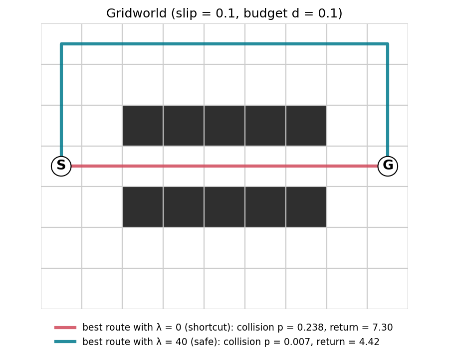
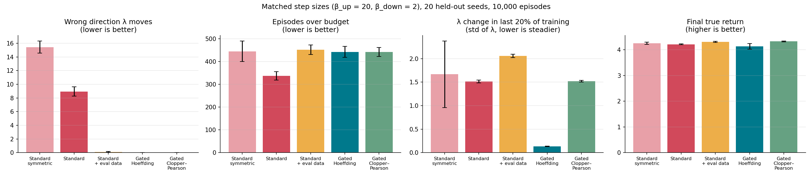
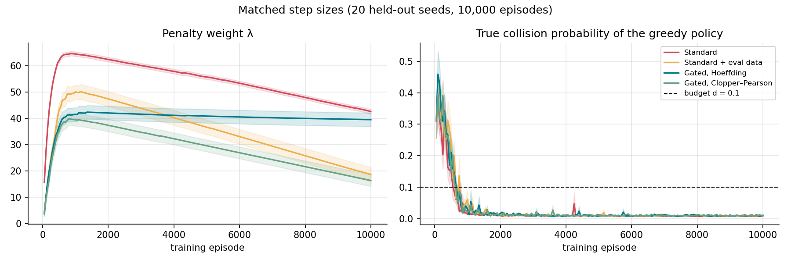

**Code and full results:** <https://github.com/AbhishekTyagi404/Safe_RL_Project>

# Abstract

Lagrangian methods are the usual way to train a reinforcement learning agent under a safety constraint. They treat the penalty weight $\lambda$ on constraint cost as a variable and move it after each batch of experience, based on an estimate of how often the constraint is broken. Early in training that estimate is noisy, so $\lambda$ can move the wrong way. We propose a confidence gated update: every $K$ episodes we freeze the current policy, run $n$ evaluation episodes, build a confidence interval for its collision probability, and move $\lambda$ only when the whole interval lies above or below the budget. We prove that, under an independence assumption that our evaluation procedure satisfies, the probability that $\lambda$ ever moves in the wrong direction during training is at most $0.82\,\delta$. We test the rule on a slippery gridworld where a delivery robot must keep its collision probability at or below 10%. Across 259 gated runs, $\lambda$ never moved the wrong way, while the standard update did so about 9 times per run. With matched step sizes, the gated rule kept $\lambda$ about 11 times steadier late in training and reached a final return within 5% of the standard rule. It did not reduce the number of episodes spent over budget; it added about 105, nearly all early in training, as it waits for evidence before raising the penalty. We found that most of the reduction in wrong moves comes from using evaluation episodes rather than training episodes, and that lowering $\lambda$ more slowly than it is raised, not gating, is what stops the agent from drifting back into risky behavior over long runs.

# 1. Objective

We set out to design and test a new rule for tuning the safety penalty in constrained reinforcement learning. Our test case is a delivery robot in a gridworld that must travel from a start cell to a goal cell while keeping its probability of hitting an obstacle in any episode at or below $d = 0.1$. Our rule changes the penalty weight only when a confidence bound on the collision rate shows that the budget is clearly met or clearly broken. When the data is not yet clear, the weight stays where it is.

The project makes three contributions, matching three of the four research directions in the course guidelines:

1. **Algorithm design.** A confidence gated Lagrangian update that works with any valid confidence interval.
2. **Theoretical result.** A proof that the gated update moves $\lambda$ in the wrong direction with probability at most $0.82\,\delta$ over the whole run.
3. **Empirical insight.** A controlled comparison that separates three effects which are easy to confuse: the gating rule itself, the extra evaluation data it uses, and the choice of step sizes for raising and lowering $\lambda$.

# 2. Motivation

A hand picked collision penalty is guesswork. If it is too small, the robot crashes often. If it is too large, the robot takes long detours and loses reward. Lagrangian methods replace the guess with a variable $\lambda$ that is raised when the estimated collision rate is above the budget and lowered when it is below [1, 2]. This removes the guesswork, but it adds a new problem: the estimate is noisy, most of all early in training when the policy is changing quickly. A noisy estimate can push $\lambda$ the wrong way, so the robot is told to take more risk when it is already over budget, or less risk when it is already safe. These wrong moves make $\lambda$ swing back and forth and can keep the robot over budget for longer than needed.

Stooke et al. [3] treat these swings as a control problem and smooth $\lambda$ with a PID controller, which changes how fast $\lambda$ moves. Thomas et al. [4, 5] use confidence bounds to decide whether a finished policy is safe enough to deploy. We test an idea that sits between these two lines of work: can statistical confidence decide **when** $\lambda$ should move during training?

# 3. Background

## 3.1 Constrained Markov decision processes

A constrained Markov decision process (CMDP) [1] adds a cost signal $c_t$ to the usual reward $r_t$. We define the cost so that $c_t = 1$ at the first collision of an episode and $0$ at every other step. The episode cost $C = \sum_t c_t$ is then 1 if the episode has any collision and 0 otherwise, so the collision probability of a policy $\pi$ is $p(\pi) = \mathbb{E}[C]$. The task is

$$\max_{\pi} \; J_R(\pi) \quad \text{subject to} \quad p(\pi) \le d,$$

where $J_R$ is the expected return and $d$ is the budget.

## 3.2 Lagrangian relaxation

The Lagrangian turns the constrained problem into a game between the policy and a multiplier $\lambda \ge 0$:

$$\min_{\lambda \ge 0} \; \max_{\pi} \; J_R(\pi) - \lambda \big( p(\pi) - d \big).$$

For a fixed $\lambda$, the policy is trained on the penalized reward $r_t - \lambda c_t$. The multiplier is then updated by projected gradient descent on the dual,

$$\lambda \leftarrow \max\big(0,\; \lambda + \beta (\hat{p} - d)\big),$$

where $\hat{p}$ is an estimate of $p(\pi)$ and $\beta$ is a step size. Paternain et al. [6] show that this relaxation has no duality gap for CMDPs when stochastic policies are allowed. With deterministic policies, as in tabular Q learning, the best response can jump between policies as $\lambda$ crosses a threshold, and $\lambda$ tends to oscillate around it.

## 3.3 Q learning

We use tabular Q learning [7, 8] with $\epsilon$ greedy exploration. After each step the agent updates

$$Q(s,a) \leftarrow Q(s,a) + \alpha \Big( r - \lambda c + \gamma \max_{a'} Q(s',a') - Q(s,a) \Big).$$

The greedy policy $\pi(s) = \arg\max_a Q(s,a)$ is the policy whose collision probability we care about.

## 3.4 Confidence intervals for a Bernoulli mean

If $C_1, \dots, C_n$ are independent Bernoulli($p$) samples with mean $\hat{p}$, a confidence interval $[L, U]$ at level $\delta$ satisfies $P(p \notin [L, U]) \le \delta$. We use four intervals:

* **Hoeffding** [9]: $\hat{p} \pm \sqrt{\ln(2/\delta) / (2n)}$. Valid for any $n$, but it ignores that the variance $p(1-p)$ is small when $p$ is near 0.
* **Empirical Bernstein** [10]: $\hat{p} \pm \Big(\sqrt{2 V_n \ln(4/\delta)/n} + 7 \ln(4/\delta) / \big(3(n-1)\big)\Big)$, where $V_n$ is the sample variance. Valid for any $n$ and tighter when $p$ is small.
* **Clopper Pearson** [11]: the exact binomial interval. Valid for any $n$ and as tight as an exact interval can be.
* **Wilson** [12]: the score interval. About as tight as Clopper Pearson, but its coverage relies on a normal approximation.

# 4. Literature Review

**Lagrangian methods for safe reinforcement learning.** Altman [1] laid out the theory of CMDPs and their Lagrangian duals. Tessler et al. [2] proposed Reward Constrained Policy Optimization, which trains the policy on a penalized reward and updates the multiplier on a slower timescale. Achiam et al. [13] took a different route with Constrained Policy Optimization, which enforces the constraint inside a trust region step instead of through a multiplier. Ray et al. [14] benchmarked Lagrangian versions of standard deep RL algorithms in Safety Gym and found them to be strong baselines. García and Fernández [15] survey the wider field of safe reinforcement learning.

**Stabilizing the multiplier.** Stooke et al. [3] showed that the standard multiplier update acts as an integral controller, which explains its overshoot and oscillation, and added proportional and derivative terms to damp it. Their method changes the size and timing of each step, but every step still reacts to a point estimate of the cost.

**Confidence bounds in reinforcement learning.** Confidence bounds appear in two other roles. Qiu et al. [16] use them for optimism: the policy is chosen under the most favorable model inside a confidence set, while the multiplier follows a standard update driven by observed costs. Thomas et al. [4] use them for high confidence policy improvement: a new policy is accepted only if a lower bound on its performance beats the current one. The Seldonian framework [5] extends this idea to general behavioral constraints, returning a solution only when a safety test passes with high confidence.

**Gap.** In the work we reviewed, confidence bounds guide exploration or decide whether a finished policy may be deployed, and the multiplier update itself reacts to point estimates. We did not find a method that uses a confidence interval to decide whether the multiplier should move at all during training. Our search was not exhaustive, so we present this as the gap we studied, not as a claim that no prior work exists.

# 5. Methodology

## 5.1 Environment

Our gridworld has 7 rows and 9 columns (Figure 1). The robot starts on the left and the goal is on the right. Two rows of five obstacles leave a narrow corridor between them. With probability 0.1 the robot slips and moves in a uniformly random direction. Each step gives reward $-1$, reaching the goal gives $+20$, and entering an obstacle ends the episode with cost 1. Episodes end after 100 steps.

{width=48%}

The environment creates a real tradeoff. Solving the penalized problem exactly by value iteration, the corridor is optimal for $\lambda$ up to about 15 and breaks the budget, while the long route is optimal from about 20 and stays far inside it. The model is known, so for any deterministic policy we can compute its **exact** collision probability and expected return by propagating the state distribution forward. We use these exact values as ground truth for every metric. This was a deliberate design choice: it lets us check each $\lambda$ move against the true collision probability instead of another noisy estimate.

## 5.2 Agent

The agent runs tabular Q learning with $\alpha = 0.1$, $\gamma = 0.99$ and $\epsilon = 0.1$. We start all Q values at 20. With zero initial values, our first runs showed the agent learning to crash on purpose: an early crash costs a single step, which looks better than wandering before the goal has been found. An optimistic start makes the agent explore until it finds the goal.

## 5.3 Update rules

Every $K = 50$ training episodes we run a check and update $\lambda$. We compare four rules:

1. **Fixed** $\lambda$: a hand picked value that never changes.
2. **Standard**: $\lambda \leftarrow \max(0, \lambda + \beta(\hat{p} - d))$, with $\hat{p}$ the collision rate of the last $K$ training episodes. This is the usual practice.
3. **Standard with evaluation data**: the same rule, but $\hat{p}$ comes from the same $n$ evaluation episodes the gated rule uses. This baseline separates the effect of gating from the effect of better data.
4. **Gated (ours)**: freeze the greedy policy $\pi_k$, run $n = 1000$ evaluation episodes with it, compute $[L_k, U_k]$ at level $\delta_k = \delta / (2k^2)$ with $\delta = 0.05$, and update

$$\lambda \leftarrow \begin{cases} \lambda + \beta_{\uparrow} (L_k - d) & \text{if } L_k > d \\ \max\big(0,\; \lambda - \beta_{\downarrow} (d - U_k)\big) & \text{if } U_k < d \\ \lambda & \text{otherwise.} \end{cases}$$

Evaluation episodes do not update the Q table and draw their randomness from a separate generator. Every rule can use separate step sizes for raising ($\beta_{\uparrow}$) and lowering ($\beta_{\downarrow}$) the multiplier; a single $\beta$ means both are equal.

## 5.4 Wrong direction guarantee

A move is in the wrong direction if $\lambda$ rises while $p(\pi_k) \le d$ or falls while $p(\pi_k) > d$.

**Theorem.** Suppose that, conditioned on everything before check $k$, the evaluation outcomes $C_{k,1}, \dots, C_{k,n}$ are independent Bernoulli($p_k$) with $p_k = p(\pi_k)$. If each interval satisfies $P(p_k \notin [L_k, U_k]) \le \delta_k$, then for any step sizes and any number of checks,

$$P\big(\lambda \text{ ever moves in the wrong direction}\big) \le \sum_{k \ge 1} \frac{\delta}{2k^2} = \frac{\pi^2}{12}\,\delta \approx 0.82\,\delta.$$

*Proof.* Let $E_k$ be the event that the interval at check $k$ covers $p_k$. On $E_k$, a move up needs $L_k > d$, so $p_k \ge L_k > d$, and a move down needs $U_k < d$, so $p_k \le U_k < d$. Both are in the right direction. A wrong move at check $k$ can therefore happen only outside $E_k$, which has probability at most $\delta_k$ by the coverage property applied conditionally and then averaged over the history. A union bound over all checks gives the result. $\square$

The assumption holds for our evaluation episodes, since they come from a frozen policy with fresh randomness. It would fail for training episodes, where the policy changes from step to step and includes exploratory actions. The coverage property holds for Hoeffding, empirical Bernstein and Clopper Pearson at every $n$. Wilson is only approximate, so the theorem does not formally cover it. The theorem says nothing about how often $\lambda$ moves, whether the constraint ends up satisfied, or whether training converges. A full write up is in `docs/proof.md` in the repository.

## 5.5 Experimental protocol

We tuned step sizes on seeds 0 to 9 and report final results on seeds 100 to 119, which were never used for tuning. Every result is a mean over seeds with its standard error, computed as the sample standard deviation (with $n-1$ in the denominator) divided by $\sqrt{n}$. For comparisons between two rules we use paired differences on the same seeds and report a 95% confidence interval from the $t$ distribution with 19 degrees of freedom, a paired $t$ test, and an exact sign flip permutation test, which makes no normality assumption. We measure:

* **Wrong direction moves**, checked against the exact $p(\pi_k)$.
* **Episodes over budget**: at each check we compute the exact collision probability of the current greedy policy, and if it is above $d$ we count the $K = 50$ training episodes since the previous check. This is an approximation: the greedy policy can change between checks. We report the second half of training separately, to catch the robot drifting back into the corridor.
* **$\lambda$ change late in training**: the standard deviation of $\lambda$ over the last 20% of checks.
* **Return**: the exact expected return of the greedy policy, both at the final check and averaged over the last 20% of checks. The greedy policy of Q learning keeps changing slightly, and a single snapshot can catch a brief wobble (Section 6.4), so the average is the steadier measure.

All experiments run on a laptop CPU in about 15 minutes in total. Every run is deterministic given its seed, and we reproduced every table on a second machine with identical results. The repository includes 17 unit tests: the confidence bounds are checked against published reference values and against exact Beta quantiles, their simulated coverage is checked, and the exact evaluation of the environment is checked against 200,000 simulated episodes per policy.

# 6. Outcomes and Discussion

## 6.1 Symmetric steps: wrong moves vanish, other metrics do not improve

Our first comparison used one step size per rule, tuned on seeds 0 to 4, and 6,000 training episodes. The gated rule (Hoeffding, $\beta = 100$) made no wrong direction moves, against 9.35 per run for the standard rule ($\beta = 20$). Episodes over budget were about the same (350 against 355), and the final return was within 5% (4.18 against 4.27). The standard rule given evaluation data made only 0.50 wrong moves. This was our first sign that most of the gain comes from the data, not the gate.

## 6.2 Over long runs every symmetric rule lets $\lambda$ decay to zero

Over 20,000 episodes (3 seeds), every rule with symmetric steps slowly drove $\lambda$ back toward 0, the gated rule included. The cause is structural. The safe route's collision probability (about 0.01) is far below the budget, so every Lagrangian rule keeps lowering the penalty while the robot is safe. Gating slows the decay but does not stop it. Q learning keeps the robot out of the corridor for a long time after the penalty is gone, so the resulting violations appear as occasional spikes, not as one clean switch. This is the oscillation described in Section 3.2, stretched out over thousands of episodes. The curves are in the repository README.

## 6.3 Tighter bounds make the decay worse

We compared the four intervals at $n = 1000$ and at smaller $n$ (Figure 2). Tighter intervals let $\lambda$ move sooner in both directions. That helps detect a violation, but it lowers $\lambda$ faster once the policy is safe. With symmetric steps, Clopper Pearson spent 410 episodes over budget in the second half of training, against 35 for Hoeffding. Intervals that are too wide fail in the opposite way: with Hoeffding at $n = 250$ the interval nearly always contained $d$, $\lambda$ stayed at its early peak of about 144, and the final return collapsed to $-3.0$. The choice of bound matters less than how quickly $\lambda$ is allowed to come down.

{width=78%}

## 6.4 Main result: matched asymmetric steps

Lowering $\lambda$ ten times slower than raising it ($\beta_{\uparrow} = 20$, $\beta_{\downarrow} = 2$) removed nearly all late violations for the gated rule. To check whether this came from gating or from the asymmetry, we gave the standard rules the same asymmetric steps. Table 1 and Figure 3 show the result on the 20 held out seeds with 10,000 episodes. All asymmetric rules use the same step sizes, so the only difference between them is what decides a move.

**Table 1.** Matched step sizes, 20 held out seeds, mean ± standard error.

| Rule | Wrong moves | Episodes over budget | Over budget, 2nd half | $\lambda$ change, last 20% | Final return | Return, last 20% |
|:---|---:|---:|---:|---:|---:|---:|
| Standard, symmetric ($\beta = 20$) | 15.45 ± 0.90 | 445 ± 45 | 98 ± 36 | 1.67 ± 0.71 | 4.26 ± 0.04 | 4.28 ± 0.01 |
| Standard | 8.95 ± 0.68 | **338 ± 18** | 0 | 1.51 ± 0.03 | 4.21 ± 0.02 | 4.12 ± 0.05 |
| Standard with evaluation data | 0.10 ± 0.07 | 453 ± 21 | 2.5 ± 2.5 | 2.06 ± 0.04 | 4.31 ± 0.02 | 4.27 ± 0.02 |
| **Gated, Hoeffding (ours)** | **0** | 443 ± 24 | 2.5 ± 2.5 | **0.13 ± 0.01** | 4.13 ± 0.11 | 4.19 ± 0.05 |
| Gated, Clopper Pearson | **0** | 443 ± 20 | 0 | 1.52 ± 0.02 | 4.32 ± 0.02 | 4.25 ± 0.04 |

{width=92%}

{width=80%}

**Answer to the research question.** Our proposal asked whether the gated update lowers the number of episodes spent over budget and the swings in $\lambda$ while keeping the final return within 5% of the standard method. Table 2 compares the gated Hoeffding rule with the standard rule on the same 20 seeds.

**Table 2.** Gated Hoeffding minus standard, paired over 20 held out seeds.

| Measure | Mean difference and 95% CI | $p$ | Answer |
|:---|:---|:---|:---|
| $\lambda$ change, last 20% | $-1.38$ $[-1.45, -1.32]$ | $< 0.0001$ | **Yes**, 11 times steadier |
| Episodes over budget | $+105$ $[+48, +162]$ | 0.001 | **No**, more over budget |
| Return, last 20% | $+0.07$ $[-0.09, +0.22]$ | 0.40 | **Yes**, no real difference |
| Return, final check | $-0.08$ $[-0.29, +0.13]$ | 0.43 | **Yes**, no real difference |
| Wrong direction moves | $-8.95$ $[-10.38, -7.52]$ | $< 0.0001$ | 0 against 8.95 |

The $p$ values come from the paired $t$ test; the exact permutation test leads to the same conclusion on every row (values in the repository). About 92 of the 105 extra episodes over budget fall in the first 800 episodes. For return, the whole 95% interval of the last 20% average lies within about 2% of the standard rule, so the 5% requirement holds with confidence, not only on average.

Seed 109 shows why we report the averaged return: the gated rule held a return near 4.4 until the very last check, where a brief wobble of the greedy policy dropped it to 2.20. Such dips occur in 0.5% to 2% of late checks for every rule.

## 6.5 Discussion

**Where the reduction in wrong moves comes from.** Given the same evaluation episodes, the standard rule falls from 8.95 to 0.10 wrong moves. Most of the improvement therefore comes from estimating the collision rate of the frozen greedy policy instead of the exploring training policy. Training episodes include random exploratory actions, so they overstate the risk of the greedy policy; the standard rule keeps raising $\lambda$ for a policy that is already safe. Gating removes the last few wrong moves and turns "rare" into a guarantee. This effect grows with a tighter budget: at $d = 0.05$ the standard rule made 55 wrong moves per run, against 1.2 with evaluation data and 0 with gating.

**Why gating costs early safety.** Early in training the greedy policy changes quickly and its collision probability is high. The standard rule reacts to every noisy batch, so $\lambda$ climbs fast and the robot finds the safe route sooner. The gated rule waits until the lower bound clears the budget, and every wait is time spent over budget. The same evaluation data without gating gives a similar count (453), so the gap against the standard rule comes mostly from the data source, which reacts later, and only partly from the gate.

**Why gating keeps $\lambda$ steady.** Once the policy is safe, Hoeffding's upper bound at $n = 1000$ sits just below the budget (about 0.088 at $k = 50$), so each downward step $\beta_{\downarrow}(d - U_k)$ is tiny. The tighter Clopper Pearson bound does not have this effect: its upper bound is near 0.03, so $\lambda$ falls at the same pace as the standard rules. The steadiness comes from the combination of gating with a conservative bound.

**Asymmetric steps stop the relapse.** With matched asymmetric steps, every rule had at most 2.5 episodes over budget in the second half of training, against 98 for the symmetric standard rule. The asymmetry, not the gate, is what keeps the robot from drifting back into the corridor.

**Cost of evaluation.** The gated rule runs 1,000 evaluation episodes per check, which is 200,000 extra episodes over a run of 10,000 training episodes. In simulation this is cheap. On a real robot, evaluation episodes carry their own risk of collision, and this cost would need to be weighed against the benefit.

**Limitations.** We tested one small tabular environment with two main routes. With deterministic greedy policies, no policy sits close to the budget, so the constraint is never tight. Our step sizes were tuned on a small set of seeds. We did not compare against PID Lagrangian methods [3], which target the same oscillation problem by a different route. Our count of episodes over budget is measured at checks, every 50 episodes, not after every episode. Q learning treats the 100 step limit as a true end of the episode instead of a cutoff; this affected 27 of 50,000 training episodes we sampled (0.05%), almost all in the first 200 episodes, so we did not change it.

# 7. Conclusion and Future Work

We proposed a Lagrangian update that moves the penalty weight only when a confidence interval on the collision rate lies fully above or below the budget, and proved that it moves the wrong way with probability at most $0.82\,\delta$. In 259 runs it never did. With matched step sizes it kept $\lambda$ about 11 times steadier and stayed within 5% of the standard rule's return, but it spent more episodes over budget early in training. Our controlled comparison showed that most of the reduction in wrong moves comes from estimating risk on a frozen policy instead of the exploring one, and that lowering $\lambda$ more slowly than raising it is what prevents a late relapse into risky behavior. For practitioners, our results suggest three changes to a standard Lagrangian setup: estimate the cost from evaluation episodes of the current policy, lower the multiplier more slowly than it is raised, and gate the update when wrong moves are expensive.

Future work could take four directions:

1. **Environments where the constraint is tight**, such as continuous control tasks in Safety Gymnasium with stochastic policies, where the optimal policy sits on the budget and wrong moves near the boundary matter most.
2. **Comparison with PID Lagrangian methods**, and a combination of the two: a PID controller that only acts when the interval clears the budget.
3. **Cheaper evaluation**, by reusing training episodes through off policy estimation, or by sequential tests that stop collecting evaluation episodes as soon as the interval clears the budget.
4. **Adaptive step sizes** that shrink $\beta_{\downarrow}$ automatically once the policy has been safe for many checks.

# References

[1] E. Altman. *Constrained Markov Decision Processes*. Chapman and Hall/CRC, 1999.

[2] C. Tessler, D. J. Mankowitz, and S. Mannor. Reward constrained policy optimization. *International Conference on Learning Representations (ICLR)*, 2019.

[3] A. Stooke, J. Achiam, and P. Abbeel. Responsive safety in reinforcement learning by PID Lagrangian methods. *International Conference on Machine Learning (ICML)*, 2020.

[4] P. S. Thomas, G. Theocharous, and M. Ghavamzadeh. High confidence policy improvement. *International Conference on Machine Learning (ICML)*, 2015.

[5] P. S. Thomas, B. Castro da Silva, A. G. Barto, S. Giguere, Y. Brun, and E. Brunskill. Preventing undesirable behavior of intelligent machines. *Science*, 366(6468):999 to 1004, 2019.

[6] S. Paternain, L. Chamon, M. Calvo Fullana, and A. Ribeiro. Constrained reinforcement learning has zero duality gap. *Advances in Neural Information Processing Systems (NeurIPS)*, 2019.

[7] C. J. C. H. Watkins and P. Dayan. Q learning. *Machine Learning*, 8:279 to 292, 1992.

[8] R. S. Sutton and A. G. Barto. *Reinforcement Learning: An Introduction*. 2nd edition, MIT Press, 2018.

[9] W. Hoeffding. Probability inequalities for sums of bounded random variables. *Journal of the American Statistical Association*, 58(301):13 to 30, 1963.

[10] A. Maurer and M. Pontil. Empirical Bernstein bounds and sample variance penalization. *Conference on Learning Theory (COLT)*, 2009.

[11] C. J. Clopper and E. S. Pearson. The use of confidence or fiducial limits illustrated in the case of the binomial. *Biometrika*, 26(4):404 to 413, 1934.

[12] E. B. Wilson. Probable inference, the law of succession, and statistical inference. *Journal of the American Statistical Association*, 22(158):209 to 212, 1927.

[13] J. Achiam, D. Held, A. Tamar, and P. Abbeel. Constrained policy optimization. *International Conference on Machine Learning (ICML)*, 2017.

[14] A. Ray, J. Achiam, and D. Amodei. Benchmarking safe exploration in deep reinforcement learning. OpenAI technical report, 2019.

[15] J. García and F. Fernández. A comprehensive survey on safe reinforcement learning. *Journal of Machine Learning Research*, 16(42):1437 to 1480, 2015.

[16] S. Qiu, X. Wei, Z. Yang, J. Ye, and Z. Wang. Upper confidence primal dual reinforcement learning for CMDP with adversarial loss. *Advances in Neural Information Processing Systems (NeurIPS)*, 2020.
